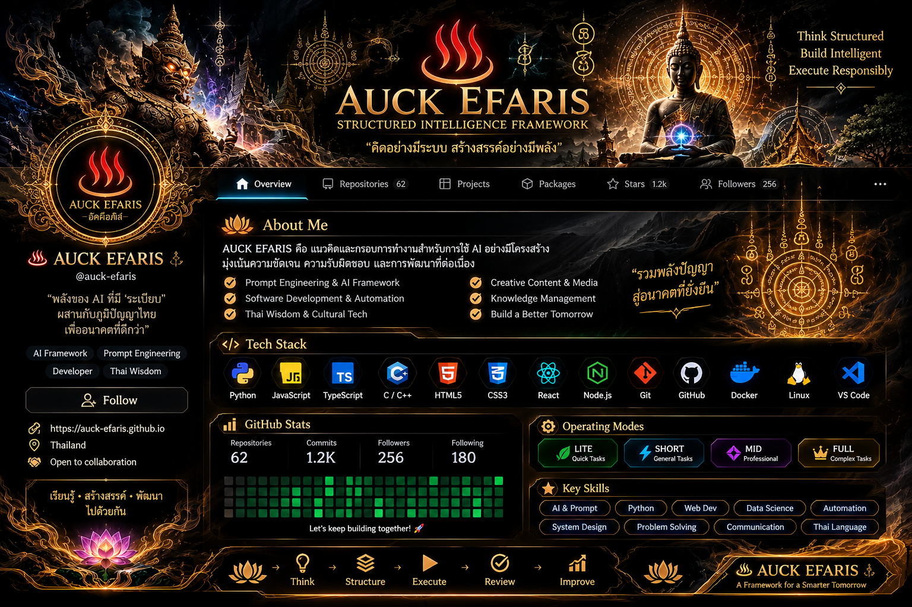

<div align="center">



# ♨ AUCK EFARIS ♮
### STRUCTURED INTELLIGENCE FRAMEWORK

**คิดอย่างมีระบบ · สร้างสรรค์อย่างมีพลัง · พัฒนาอย่างรับผิดชอบ**

[](https://github.com/)
[](https://github.com/)
[](https://github.com/)

</div>

---

## 🪷 เกี่ยวกับ AUCK EFARIS

**AUCK EFARIS** คือแนวคิดและกรอบการทำงานสำหรับการใช้ AI อย่างมีโครงสร้าง มุ่งเน้นความชัดเจนของคำสั่ง การจัดการบริบท การกำหนดผลลัพธ์ และการตรวจทานโดยมนุษย์

> “พลังของ AI จะเกิดประโยชน์สูงสุด เมื่อมีโครงสร้างและทิศทางที่ชัดเจน”

- ♨ Prompt Engineering & AI Framework
- 🧭 Structured Thinking & Problem Solving
- 🛠️ Software, Tools & Automation
- 🪷 Thai-inspired design and digital identity
- 🔎 Review, refinement and responsible AI use

## 🔱 AUCK EFARIS Framework

| Element | Focus | Purpose |
|:---:|---|---|
| **A** | Agent | กำหนดบทบาทและเป้าหมาย |
| **U** | Universe | ระบุบริบทและข้อจำกัด |
| **C** | Command | กำหนดคำสั่งให้ชัดเจน |
| **K** | Know-How | ระบุแนวทางดำเนินงาน |
| **E** | Expression | กำหนดรูปแบบ ภาษา และน้ำเสียง |
| **F** | Final Expectation | ระบุเกณฑ์ความสำเร็จ |
| **R** | Review | ตรวจสอบความครบถ้วนและคุณภาพ |

**ARIS Loop:** Adjust → Review → Improve → Sharpen

## 🧿 Tech Stack & Tools

> รายการด้านล่างเป็นชุดเริ่มต้นสำหรับปรับแต่ง — ลบไอคอนของภาษา/เครื่องมือที่ยังไม่ได้ใช้จริง และเพิ่มรายการของคุณก่อนเผยแพร่

<div align="center">

### Languages


### Frameworks & Runtime


### Tools & Platforms


</div>

## ⚔️ Skills & Focus

- **AI & Prompt Design** — prompt structure, context design, output review
- **Programming** — แสดงภาษาและเทคโนโลยีที่ใช้งานจริงในส่วน Tech Stack
- **Problem Solving** — แยกปัญหา กำหนดเงื่อนไข และตรวจผลลัพธ์
- **Knowledge Organization** — จัดระบบข้อมูลและเอกสาร
- **Creative Technology** — ผสานแนวคิดสร้างสรรค์กับเครื่องมือดิจิทัล

## 📜 Operating Modes

| Mode | ใช้เมื่อ |
|---|---|
| `LITE` | งานสั้น ทดลอง หรือโจทย์ไม่ซับซ้อน |
| `SHORT` | งานทั่วไปที่มีเป้าหมายชัดเจน |
| `MID` | งานจริงจังที่ต้องกำหนดขั้นตอนและเกณฑ์ |
| `FULL` | งานซับซ้อนที่ต้องระบุขอบเขตและตรวจทานละเอียด |

**หลักการ:** เลือกโครงสร้างที่เบาที่สุด แต่เพียงพอกับงาน

## 🧭 Workflow

```text
THINK
  ↓
STRUCTURE
  ↓
EXECUTE
  ↓
REVIEW
  ↓
IMPROVE
```

## 📊 GitHub Activity

<!-- เปลี่ยน YOUR_GITHUB_USERNAME เป็น GitHub username ของคุณ -->
<div align="center">


<br>


</div>

## 🪷 Philosophy

**Structure the thinking. Elevate the output.**

เรียนรู้ · สร้างสรรค์ · พัฒนา · ส่งต่อสิ่งที่มีคุณค่า

<div align="center">

♨ **AUCK EFARIS ♮**

<sub>A Thai-inspired identity for structured intelligence and responsible creation.</sub>

</div>
